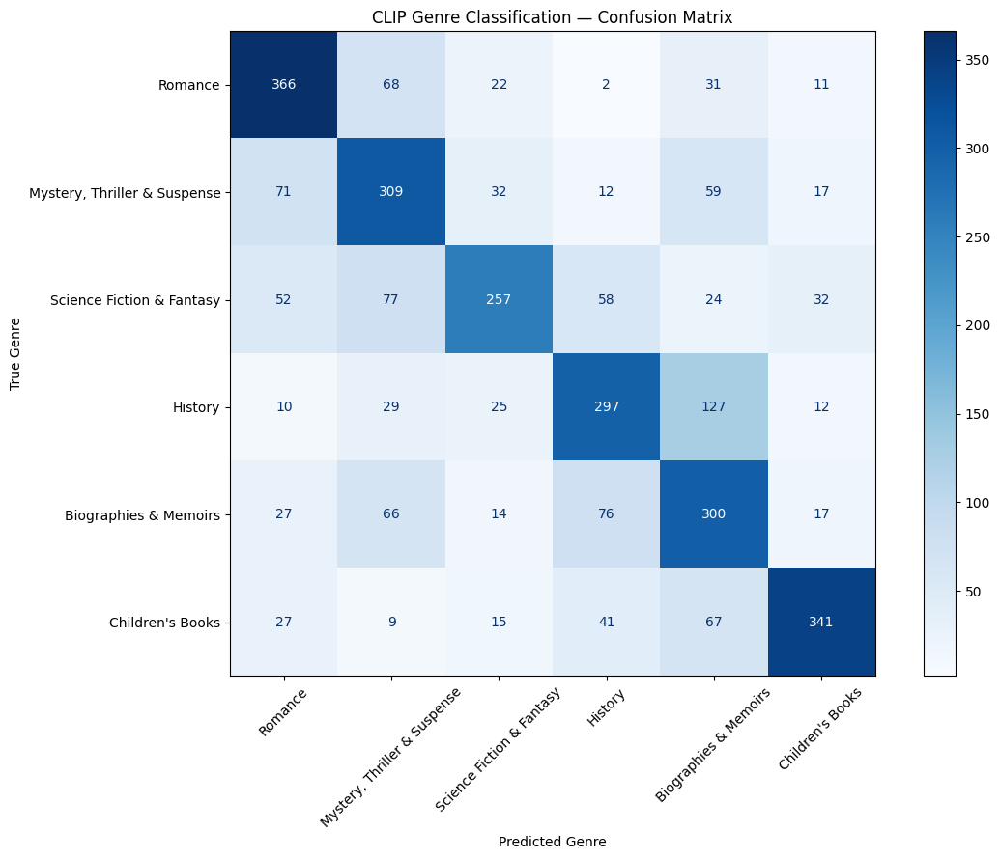
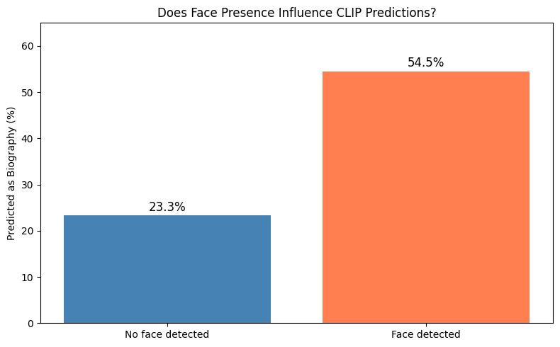
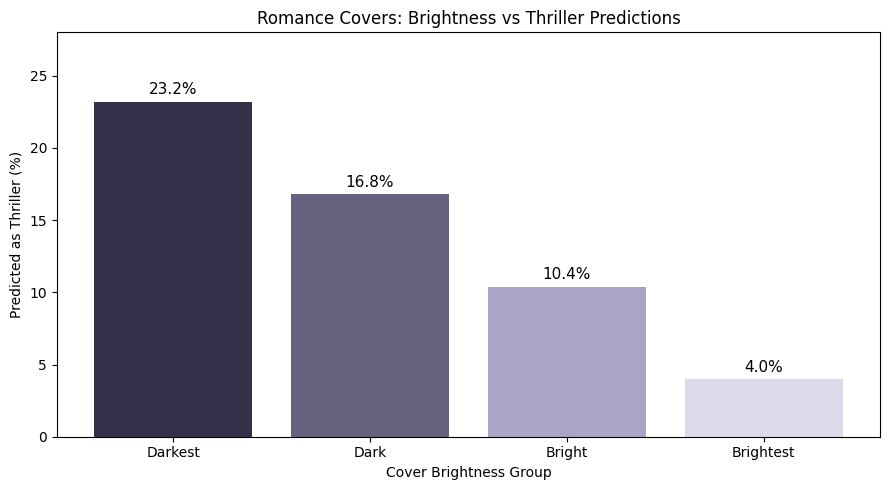
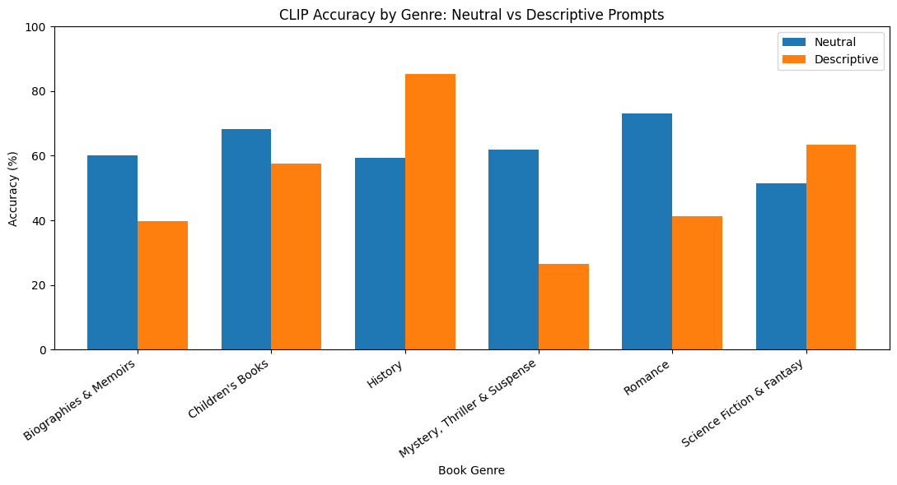
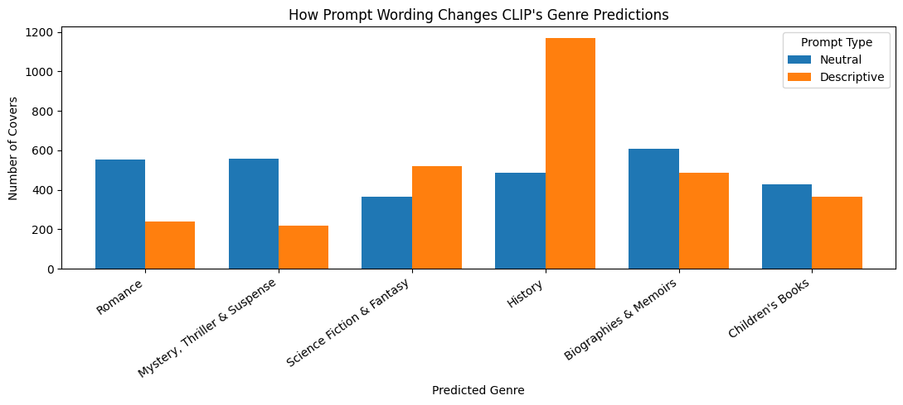
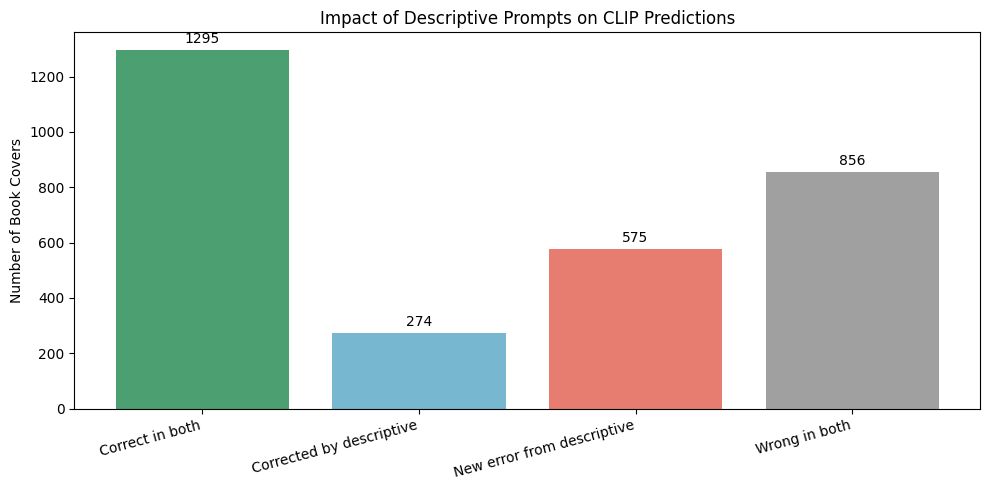

# Phase I Research Report — AI-Aided Pair

## Judging a Book by Its Cover
**Genre Bias & Visual Stereotypes in AI**

**Team:** Marshmallow Bunnies  
**Model:** [CLIP ViT-B/32](https://huggingface.co/openai/clip-vit-base-patch32)  
**Dataset:** BookCover30

## 1. Research Objective

This project investigates how CLIP classifies book covers into genres and whether its predictions are associated with visual stereotypes.

We focus on four research questions:

1. Which book genres does CLIP classify most accurately, and which genres are frequently confused?
2. Are visual features such as faces and brightness associated with classification errors?
3. How does changing text prompts affect predictions?
4. How reliable are CLIP's confidence scores?

We analyze CLIP as a black-box model, using its predictions and outputs without examining its internal representations.

## 2. Dataset and Methodology

We use a balanced subset of the BookCover30 dataset containing **3,000 book covers**, with 500 images from each of six genres:

- Romance
- Mystery, Thriller & Suspense
- Science Fiction & Fantasy
- History
- Biographies & Memoirs
- Children's Books

We use the pretrained CLIP ViT-B/32 model for zero-shot classification. Each cover is compared with text descriptions of the six genres, and the genre with the highest similarity score is selected.

Our analysis includes confusion matrices, visual inspection of classification errors, face detection, brightness measurements, prompt comparisons, and confidence analysis.

## 3. Genre Classification Performance

With neutral text prompts, CLIP achieved an overall classification accuracy of **62.33%**.

The highest accuracy was observed for Romance (73.2%) and Children's Books (68.2%). Science Fiction & Fantasy had the lowest accuracy (51.4%).

The confusion matrix revealed systematic errors between visually similar genres. For example, 127 History covers were classified as Biographies & Memoirs.

These findings suggest that CLIP recognizes genre-related visual patterns, but that similarities in cover design can lead to confusion.

## 4. Visual Features and Classification Errors

### 4.1 Face Presence

We investigated whether History book covers containing detectable human faces were more likely to be classified as Biographies & Memoirs.

Among 500 History covers, the face detector identified faces in 33 images.

- With a detected face, 54.5% were predicted as Biographies & Memoirs.
- Without a detected face, 23.3% were predicted as Biographies & Memoirs.

The results show an association between detected faces and Biography predictions. However, face detection is imperfect, and this experiment does not establish a causal relationship.

### 4.2 Cover Brightness

We investigated whether darker Romance book covers were more frequently misclassified as Mystery, Thriller & Suspense.

We calculated average grayscale brightness and divided the 500 Romance covers into four equally sized groups.

| Brightness group | Predicted as Thriller |
|---|---:|
| Darkest | 23.2% |
| Dark | 16.8% |
| Bright | 10.4% |
| Brightest | 4.0% |

The darkest Romance covers were 5.8 times as likely to receive Thriller predictions as the brightest covers.

This suggests that darker visual styles are associated with Thriller predictions, although brightness alone cannot explain the model's behavior.

## 5. Prompt Sensitivity

We compared neutral genre prompts with more descriptive prompts containing genre-related themes.

The results were:

| Prompt type | Overall accuracy |
|---|---:|
| Neutral | 62.33% |
| Descriptive | 52.30% |

Changing the prompts altered **1,199 out of 3,000 predictions (39.97%)**.

Descriptive prompts improved classification accuracy for History and Science Fiction & Fantasy, but reduced performance for several other genres.

A particularly interesting result was the increase in History predictions from 486 with neutral prompts to 1,168 with descriptive prompts.

This indicates that CLIP is highly sensitive to prompt wording. More detailed descriptions do not necessarily improve overall classification performance and can shift predictions strongly toward particular genres.

## 6. Corrected Predictions and New Errors

We examined how individual predictions changed after switching to descriptive prompts.

| Prediction outcome | Number of covers |
|---|---:|
| Correct with both prompts | 1,295 |
| Corrected by descriptive prompts | 274 |
| New errors from descriptive prompts | 575 |
| Incorrect with both prompts | 856 |

Although descriptive prompts corrected 274 previous errors, they introduced 575 new errors.

We also inspected examples of changed predictions to explore possible visual patterns.

These results show that prompt changes can help individual cases while reducing overall performance.

## 7. Confidence and Model Reliability

We compared CLIP's confidence scores for correct and incorrect predictions.

Correct predictions had an average confidence of **0.717**, compared with **0.559** for incorrect predictions.

Higher-confidence predictions generally had lower error rates:

- At confidence of at least 90%, the error rate was 10.84%.
- At confidence of at least 95%, the error rate was 7.25%.

However, 15 predictions with confidence of at least 95% were still incorrect.

These findings suggest that confidence is associated with prediction correctness, but high confidence does not guarantee a correct classification. CLIP's softmax scores should not automatically be interpreted as calibrated probabilities.

## 8. Interactive Dashboard

We developed a Streamlit dashboard to explore the saved classification results interactively.

The dashboard provides an overview of classification performance, genre-level analysis, an error explorer, prompt comparisons, and confidence analysis.

It allows users to investigate individual predictions and visually examine model behavior without rerunning CLIP inference.

The dashboard source code is available in [`dashboard/dashboard.py`](../dashboard/dashboard.py).

## 9. Limitations

Our investigation has several limitations.

First, we used a balanced subset of six genres rather than the complete BookCover30 dataset. Results may differ for other genres or sampling strategies.

Second, face detection and average brightness provide only simplified measurements of visual characteristics. They cannot fully describe cover design or establish which features CLIP actually uses.

Third, we compared two sets of prompts. Other formulations could produce different results.

Finally, high softmax confidence does not necessarily represent a calibrated probability of correctness.

## 10. Conclusion

Our experiments show that CLIP can identify visual patterns associated with book genres, but its predictions have important limitations.

We observed systematic confusion between genres, associations between visual characteristics and classification errors, and substantial sensitivity to prompt wording.

We also found that CLIP can produce incorrect predictions with high confidence.

Our results suggest that CLIP's classification behavior depends on both the visual appearance of book covers and the text descriptions used for classification. Understanding these dependencies is important when evaluating zero-shot vision-language models.
