# Phase I: Book Cover Genre Classification with CLIP

**Model:** openai/clip-vit-base-patch32  
**Dataset:** BookCover30  
**Task:** Investigating genre bias and visual stereotypes in book cover classification.

In this phase, we analyze CLIP as a black-box model to understand how visual features and text prompts influence its genre predictions.


### 1.1 Dataset Structure

Check that the dataset directory exists and list the available files.


```python
from pathlib import Path
import pandas as pd

DATA_DIR = Path("archive")

print("Dataset folder exists:", DATA_DIR.exists())

for item in DATA_DIR.iterdir():
    print(item.name)

```

    Dataset folder exists: True
    title30cat
    book30-listing-train.csv
    bookcover30-labels-test.txt
    book30-listing-test.csv
    book32-listing.csv
    bookcover30-labels-train.txt
    


### 1.2 Dataset Metadata

Load the training and test metadata to inspect their structure, columns, and number of samples.


```python
train_df = pd.read_csv(DATA_DIR / "book30-listing-train.csv", sep=";")
test_df = pd.read_csv(DATA_DIR / "book30-listing-test.csv", sep=";")

print("Train shape:", train_df.shape)
print("Test shape:", test_df.shape)

display(train_df.head())
display(test_df.head())

print("Columns:", train_df.columns.tolist())

```

    Train shape: (51300, 7)
    Test shape: (5700, 7)
    


<div>
<style scoped>
    .dataframe tbody tr th:only-of-type {
        vertical-align: middle;
    }

    .dataframe tbody tr th {
        vertical-align: top;
    }

    .dataframe thead th {
        text-align: right;
    }
</style>
<table border="1" class="dataframe">
  <thead>
    <tr style="text-align: right;">
      <th></th>
      <th>Amazon Index (ASIN)</th>
      <th>Filename</th>
      <th>Image URL</th>
      <th>Title</th>
      <th>Author</th>
      <th>Category ID</th>
      <th>Category</th>
    </tr>
  </thead>
  <tbody>
    <tr>
      <th>0</th>
      <td>1588345297</td>
      <td>1588345297.jpg</td>
      <td>http://ecx.images-amazon.com/images/I/51l6XIoa...</td>
      <td>With Schwarzkopf: Life Lessons of The Bear</td>
      <td>Gus Lee</td>
      <td>1</td>
      <td>Biographies &amp; Memoirs</td>
    </tr>
    <tr>
      <th>1</th>
      <td>1404803335</td>
      <td>1404803335.jpg</td>
      <td>http://ecx.images-amazon.com/images/I/51UJnL3T...</td>
      <td>Magnets: Pulling Together, Pushing Apart (Amaz...</td>
      <td>Natalie M. Rosinsky</td>
      <td>4</td>
      <td>Children's Books</td>
    </tr>
    <tr>
      <th>2</th>
      <td>1446276082</td>
      <td>1446276082.jpg</td>
      <td>http://ecx.images-amazon.com/images/I/51MGUKhk...</td>
      <td>Energy Security (SAGE Library of International...</td>
      <td>NaN</td>
      <td>10</td>
      <td>Engineering &amp; Transportation</td>
    </tr>
    <tr>
      <th>3</th>
      <td>1491522666</td>
      <td>1491522666.jpg</td>
      <td>http://ecx.images-amazon.com/images/I/51qKvjsi...</td>
      <td>An Amish Gathering: Life in Lancaster County</td>
      <td>Beth Wiseman</td>
      <td>9</td>
      <td>Christian Books &amp; Bibles</td>
    </tr>
    <tr>
      <th>4</th>
      <td>970096410</td>
      <td>0970096410.jpg</td>
      <td>http://ecx.images-amazon.com/images/I/51qoUENb...</td>
      <td>City of Rocks Idaho: A Climber's Guide (Region...</td>
      <td>Dave Bingham</td>
      <td>26</td>
      <td>Sports &amp; Outdoors</td>
    </tr>
  </tbody>
</table>
</div>


<div>
<style scoped>
    .dataframe tbody tr th:only-of-type {
        vertical-align: middle;
    }

    .dataframe tbody tr th {
        vertical-align: top;
    }

    .dataframe thead th {
        text-align: right;
    }
</style>
<table border="1" class="dataframe">
  <thead>
    <tr style="text-align: right;">
      <th></th>
      <th>Amazon Index (ASIN)</th>
      <th>Filename</th>
      <th>Image URL</th>
      <th>Title</th>
      <th>Author</th>
      <th>Category ID</th>
      <th>Category</th>
    </tr>
  </thead>
  <tbody>
    <tr>
      <th>0</th>
      <td>044310073X</td>
      <td>044310073X.jpg</td>
      <td>http://ecx.images-amazon.com/images/I/41kSLEos...</td>
      <td>Oral and Maxillofacial Surgery: An Objective-B...</td>
      <td>NaN</td>
      <td>16</td>
      <td>Medical Books</td>
    </tr>
    <tr>
      <th>1</th>
      <td>1438005687</td>
      <td>1438005687.jpg</td>
      <td>http://ecx.images-amazon.com/images/I/510l0qhi...</td>
      <td>Barron's GRE, 21st Edition</td>
      <td>Sharon Weiner Green M.A.</td>
      <td>28</td>
      <td>Test Preparation</td>
    </tr>
    <tr>
      <th>2</th>
      <td>60750715</td>
      <td>0060750715.jpg</td>
      <td>http://ecx.images-amazon.com/images/I/51p5aUY%...</td>
      <td>George Balanchine: The Ballet Maker (Eminent L...</td>
      <td>Robert Gottlieb</td>
      <td>1</td>
      <td>Biographies &amp; Memoirs</td>
    </tr>
    <tr>
      <th>3</th>
      <td>1580237959</td>
      <td>1580237959.jpg</td>
      <td>http://ecx.images-amazon.com/images/I/51pum0eW...</td>
      <td>A Partner in Holiness: Deepening Mindfulness, ...</td>
      <td>Rabbi Jonathan P. Slater DMin</td>
      <td>21</td>
      <td>Religion &amp; Spirituality</td>
    </tr>
    <tr>
      <th>4</th>
      <td>135137829</td>
      <td>0135137829.jpg</td>
      <td>http://ecx.images-amazon.com/images/I/51PuTPPC...</td>
      <td>Construction Scheduling: Principles and Practi...</td>
      <td>Jay S. Newitt</td>
      <td>0</td>
      <td>Arts &amp; Photography</td>
    </tr>
  </tbody>
</table>
</div>


    Columns: ['Amazon Index (ASIN)', 'Filename', 'Image URL', 'Title', 'Author', 'Category ID', 'Category']
    


### 1.3 Dataset Exploration

Explore the available book categories, their distribution, and the number of locally available cover images.


```python
# Explore categories
category_counts = train_df["Category"].value_counts()

print("Number of categories:", train_df["Category"].nunique())
display(category_counts.to_frame("Number of books"))

# Check local images
IMAGE_DIR = DATA_DIR / "title30cat"
image_files = list(IMAGE_DIR.rglob("*.jpg"))

print("\nTotal local images:", len(image_files))
print("Example image paths:")
for path in image_files[:5]:
    print(path)

```

    Number of categories: 30
    


<div>
<style scoped>
    .dataframe tbody tr th:only-of-type {
        vertical-align: middle;
    }

    .dataframe tbody tr th {
        vertical-align: top;
    }

    .dataframe thead th {
        text-align: right;
    }
</style>
<table border="1" class="dataframe">
  <thead>
    <tr style="text-align: right;">
      <th></th>
      <th>Number of books</th>
    </tr>
    <tr>
      <th>Category</th>
      <th></th>
    </tr>
  </thead>
  <tbody>
    <tr>
      <th>Biographies &amp; Memoirs</th>
      <td>1710</td>
    </tr>
    <tr>
      <th>Children's Books</th>
      <td>1710</td>
    </tr>
    <tr>
      <th>Science Fiction &amp; Fantasy</th>
      <td>1710</td>
    </tr>
    <tr>
      <th>Calendars</th>
      <td>1710</td>
    </tr>
    <tr>
      <th>Self-Help</th>
      <td>1710</td>
    </tr>
    <tr>
      <th>Teen &amp; Young Adult</th>
      <td>1710</td>
    </tr>
    <tr>
      <th>Reference</th>
      <td>1710</td>
    </tr>
    <tr>
      <th>Comics &amp; Graphic Novels</th>
      <td>1710</td>
    </tr>
    <tr>
      <th>History</th>
      <td>1710</td>
    </tr>
    <tr>
      <th>Romance</th>
      <td>1710</td>
    </tr>
    <tr>
      <th>Parenting &amp; Relationships</th>
      <td>1710</td>
    </tr>
    <tr>
      <th>Arts &amp; Photography</th>
      <td>1710</td>
    </tr>
    <tr>
      <th>Test Preparation</th>
      <td>1710</td>
    </tr>
    <tr>
      <th>Computers &amp; Technology</th>
      <td>1710</td>
    </tr>
    <tr>
      <th>Law</th>
      <td>1710</td>
    </tr>
    <tr>
      <th>Humor &amp; Entertainment</th>
      <td>1710</td>
    </tr>
    <tr>
      <th>Literature &amp; Fiction</th>
      <td>1710</td>
    </tr>
    <tr>
      <th>Religion &amp; Spirituality</th>
      <td>1710</td>
    </tr>
    <tr>
      <th>Crafts, Hobbies &amp; Home</th>
      <td>1710</td>
    </tr>
    <tr>
      <th>Politics &amp; Social Sciences</th>
      <td>1710</td>
    </tr>
    <tr>
      <th>Cookbooks, Food &amp; Wine</th>
      <td>1710</td>
    </tr>
    <tr>
      <th>Business &amp; Money</th>
      <td>1710</td>
    </tr>
    <tr>
      <th>Travel</th>
      <td>1710</td>
    </tr>
    <tr>
      <th>Science &amp; Math</th>
      <td>1710</td>
    </tr>
    <tr>
      <th>Medical Books</th>
      <td>1710</td>
    </tr>
    <tr>
      <th>Health, Fitness &amp; Dieting</th>
      <td>1710</td>
    </tr>
    <tr>
      <th>Sports &amp; Outdoors</th>
      <td>1710</td>
    </tr>
    <tr>
      <th>Christian Books &amp; Bibles</th>
      <td>1710</td>
    </tr>
    <tr>
      <th>Engineering &amp; Transportation</th>
      <td>1710</td>
    </tr>
    <tr>
      <th>Mystery, Thriller &amp; Suspense</th>
      <td>1710</td>
    </tr>
  </tbody>
</table>
</div>


    
    Total local images: 57000
    Example image paths:
    archive/title30cat/224x224/0205762611.jpg
    archive/title30cat/224x224/1455599719.jpg
    archive/title30cat/224x224/145940078X.jpg
    archive/title30cat/224x224/0060891548.jpg
    archive/title30cat/224x224/1248411560.jpg
    


### 1.4 Genre Selection

We selected six book categories with potentially distinctive visual characteristics to investigate whether CLIP relies on colors, illustrations, and common cover design patterns when predicting genres.


```python
selected_genres = [
    "Romance",
    "Mystery, Thriller & Suspense",
    "Science Fiction & Fantasy",
    "History",
    "Biographies & Memoirs",
    "Children's Books"
]

# Select 500 images per genre from the training split
selected_df = (
    train_df[train_df["Category"].isin(selected_genres)]
    .groupby("Category", group_keys=False)
    .sample(n=500, random_state=42)
    .reset_index(drop=True)
)

# Add local image paths
selected_df["image_path"] = selected_df["Filename"].apply(
    lambda name: str(IMAGE_DIR / "224x224" / name)
)

# Check image availability
selected_df["image_exists"] = selected_df["image_path"].apply(
    lambda path: Path(path).is_file()
)

print("Selected images:", len(selected_df))
print("Available images:", selected_df["image_exists"].sum())

display(selected_df["Category"].value_counts())

```

    Selected images: 3000
    Available images: 3000
    


    Category
    Biographies & Memoirs           500
    Children's Books                500
    History                         500
    Mystery, Thriller & Suspense    500
    Romance                         500
    Science Fiction & Fantasy       500
    Name: count, dtype: int64


### 1.5 Visualizing Book Covers

Display sample book covers from each selected genre to explore potential visual patterns and formulate initial hypotheses about genre stereotypes.


```python
import matplotlib.pyplot as plt
from PIL import Image

fig, axes = plt.subplots(6, 5, figsize=(14, 19))

for row, genre in enumerate(selected_genres):
    samples = selected_df[
        selected_df["Category"] == genre
    ].sample(n=5, random_state=42)

    for col, (_, book) in enumerate(samples.iterrows()):
        img = Image.open(book["image_path"]).convert("RGB")

        axes[row, col].imshow(img)
        axes[row, col].axis("off")

        if col == 0:
            axes[row, col].set_ylabel(
                genre,
                fontsize=11,
                rotation=0,
                labelpad=95,
                va="center"
            )

plt.suptitle("Sample Book Covers by Genre", fontsize=16)
plt.tight_layout()
plt.show()

```


    
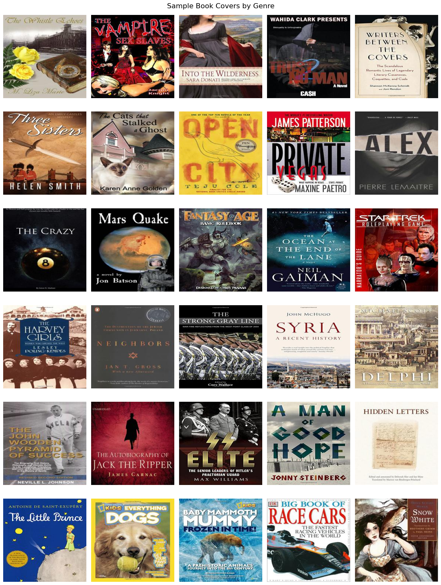
    


## 2. CLIP Model Setup

Load the pre-trained CLIP model for zero-shot book genre classification. We will compare each cover image with text descriptions of the six selected genres.


```python
%pip install torch transformers pillow tqdm
```

    Requirement already satisfied: torch in /opt/homebrew/lib/python3.11/site-packages (2.9.1)
    Requirement already satisfied: transformers in /opt/homebrew/lib/python3.11/site-packages (4.57.6)
    Requirement already satisfied: pillow in /opt/homebrew/lib/python3.11/site-packages (12.0.0)
    Requirement already satisfied: tqdm in /opt/homebrew/lib/python3.11/site-packages (4.67.1)
    Requirement already satisfied: filelock in /opt/homebrew/lib/python3.11/site-packages (from torch) (3.20.3)
    Requirement already satisfied: typing-extensions>=4.10.0 in /opt/homebrew/lib/python3.11/site-packages (from torch) (4.16.0)
    Requirement already satisfied: sympy>=1.13.3 in /opt/homebrew/lib/python3.11/site-packages (from torch) (1.14.0)
    Requirement already satisfied: networkx>=2.5.1 in /opt/homebrew/lib/python3.11/site-packages (from torch) (3.6.1)
    Requirement already satisfied: jinja2 in /Users/milana/Library/Python/3.11/lib/python/site-packages (from torch) (3.1.6)
    Requirement already satisfied: fsspec>=0.8.5 in /opt/homebrew/lib/python3.11/site-packages (from torch) (2026.1.0)
    Requirement already satisfied: huggingface-hub<1.0,>=0.34.0 in /opt/homebrew/lib/python3.11/site-packages (from transformers) (0.36.0)
    Requirement already satisfied: numpy>=1.17 in /opt/homebrew/lib/python3.11/site-packages (from transformers) (2.4.6)
    Requirement already satisfied: packaging>=20.0 in /Users/milana/Library/Python/3.11/lib/python/site-packages (from transformers) (25.0)
    Requirement already satisfied: pyyaml>=5.1 in /Users/milana/Library/Python/3.11/lib/python/site-packages (from transformers) (6.0.3)
    Requirement already satisfied: regex!=2019.12.17 in /opt/homebrew/lib/python3.11/site-packages (from transformers) (2026.1.15)
    Requirement already satisfied: requests in /Users/milana/Library/Python/3.11/lib/python/site-packages (from transformers) (2.32.5)
    Requirement already satisfied: tokenizers<=0.23.0,>=0.22.0 in /opt/homebrew/lib/python3.11/site-packages (from transformers) (0.22.2)
    Requirement already satisfied: safetensors>=0.4.3 in /opt/homebrew/lib/python3.11/site-packages (from transformers) (0.7.0)
    Requirement already satisfied: hf-xet<2.0.0,>=1.1.3 in /opt/homebrew/lib/python3.11/site-packages (from huggingface-hub<1.0,>=0.34.0->transformers) (1.2.0)
    Requirement already satisfied: mpmath<1.4,>=1.1.0 in /opt/homebrew/lib/python3.11/site-packages (from sympy>=1.13.3->torch) (1.3.0)
    Requirement already satisfied: MarkupSafe>=2.0 in /Users/milana/Library/Python/3.11/lib/python/site-packages (from jinja2->torch) (3.0.3)
    Requirement already satisfied: charset_normalizer<4,>=2 in /Users/milana/Library/Python/3.11/lib/python/site-packages (from requests->transformers) (3.4.4)
    Requirement already satisfied: idna<4,>=2.5 in /Users/milana/Library/Python/3.11/lib/python/site-packages (from requests->transformers) (3.11)
    Requirement already satisfied: urllib3<3,>=1.21.1 in /Users/milana/Library/Python/3.11/lib/python/site-packages (from requests->transformers) (2.6.2)
    Requirement already satisfied: certifi>=2017.4.17 in /Users/milana/Library/Python/3.11/lib/python/site-packages (from requests->transformers) (2025.11.12)
    
    [notice] A new release of pip is available: 23.3.1 -> 26.3
    [notice] To update, run: python3.11 -m pip install --upgrade pip
    Note: you may need to restart the kernel to use updated packages.
    


```python
import torch
from transformers import CLIPModel, CLIPProcessor

MODEL_NAME = "openai/clip-vit-base-patch32"

device = (
    "mps" if torch.backends.mps.is_available()
    else "cuda" if torch.cuda.is_available()
    else "cpu"
)

print("Device:", device)

model = CLIPModel.from_pretrained(MODEL_NAME).to(device)
processor = CLIPProcessor.from_pretrained(MODEL_NAME)

model.eval()

print("CLIP loaded successfully!")

```

    Device: mps
    

    Using a slow image processor as `use_fast` is unset and a slow processor was saved with this model. `use_fast=True` will be the default behavior in v4.52, even if the model was saved with a slow processor. This will result in minor differences in outputs. You'll still be able to use a slow processor with `use_fast=False`.
    

    CLIP loaded successfully!
    

### 2.1 First CLIP Predictions

Test CLIP on one book cover from each selected genre and compare its zero-shot predictions with the true labels.


```python
# Define text prompts for each genre
text_prompts = [
    f"A book cover of a {genre} book."
    for genre in selected_genres
]

# Select one image per genre
sample_books = (
    selected_df.groupby("Category", group_keys=False)
    .sample(n=1, random_state=42)
)

fig, axes = plt.subplots(1, 6, figsize=(18, 5))

for ax, (_, book) in zip(axes, sample_books.iterrows()):
    image = Image.open(book["image_path"]).convert("RGB")

    inputs = processor(
        text=text_prompts,
        images=image,
        return_tensors="pt",
        padding=True
    ).to(device)

    with torch.no_grad():
        outputs = model(**inputs)
        probabilities = outputs.logits_per_image.softmax(dim=1)

    predicted_idx = probabilities.argmax(dim=1).item()
    predicted_genre = selected_genres[predicted_idx]

    ax.imshow(image)
    ax.axis("off")
    ax.set_title(
        f"True: {book['Category']}\n"
        f"Pred: {predicted_genre}",
        fontsize=9,
        color="green" if predicted_genre == book["Category"] else "red"
    )

plt.tight_layout()
plt.show()

```


    
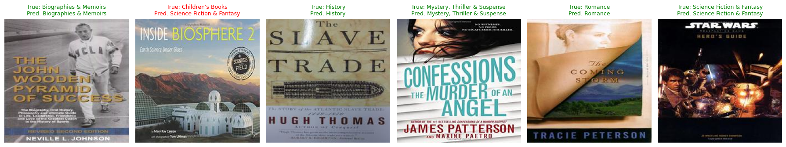
    


### 2.2 Genre Predictions on the Full Dataset

Run CLIP on all 3,000 book covers in batches and save the predicted genres and similarity scores for further analysis.


```python
from tqdm.auto import tqdm
import numpy as np

batch_size = 16
all_probabilities = []

for start in tqdm(range(0, len(selected_df), batch_size)):
    batch = selected_df.iloc[start:start + batch_size]

    images = [
        Image.open(path).convert("RGB")
        for path in batch["image_path"]
    ]

    inputs = processor(
        text=text_prompts,
        images=images,
        return_tensors="pt",
        padding=True
    ).to(device)

    with torch.inference_mode():
        outputs = model(**inputs)
        probs = outputs.logits_per_image.softmax(dim=1)

    all_probabilities.append(probs.cpu().numpy())

# Combine results
all_probabilities = np.concatenate(all_probabilities, axis=0)

# Save predictions
selected_df["predicted_genre"] = [
    selected_genres[i]
    for i in all_probabilities.argmax(axis=1)
]

selected_df["confidence"] = all_probabilities.max(axis=1)

for i, genre in enumerate(selected_genres):
    selected_df[f"prob_{i}"] = all_probabilities[:, i]

selected_df["correct"] = (
    selected_df["Category"] == selected_df["predicted_genre"]
)

# Save results
selected_df.to_csv("clip_predictions.csv", index=False)

print("Total predictions:", len(selected_df))
print("Accuracy:", round(selected_df["correct"].mean(), 3))
print("Results saved to clip_predictions.csv")

```


      0%|          | 0/188 [00:00<?, ?it/s]


    Total predictions: 3000
    Accuracy: 0.623
    Results saved to clip_predictions.csv
    

## 3. Model Behavior Analysis

### 3.1 Confusion Matrix

Visualize the relationship between true and predicted genres to identify systematic classification errors and frequently confused genre pairs.


```python
from sklearn.metrics import confusion_matrix, ConfusionMatrixDisplay

cm = confusion_matrix(
    selected_df["Category"],
    selected_df["predicted_genre"],
    labels=selected_genres
)

fig, ax = plt.subplots(figsize=(12, 9))

disp = ConfusionMatrixDisplay(
    confusion_matrix=cm,
    display_labels=selected_genres
)

disp.plot(
    ax=ax,
    cmap="Blues",
    values_format="d",
    xticks_rotation=45,
    colorbar=True
)

plt.title("CLIP Genre Classification — Confusion Matrix")
plt.xlabel("Predicted Genre")
plt.ylabel("True Genre")
plt.tight_layout()
plt.show()

```


    
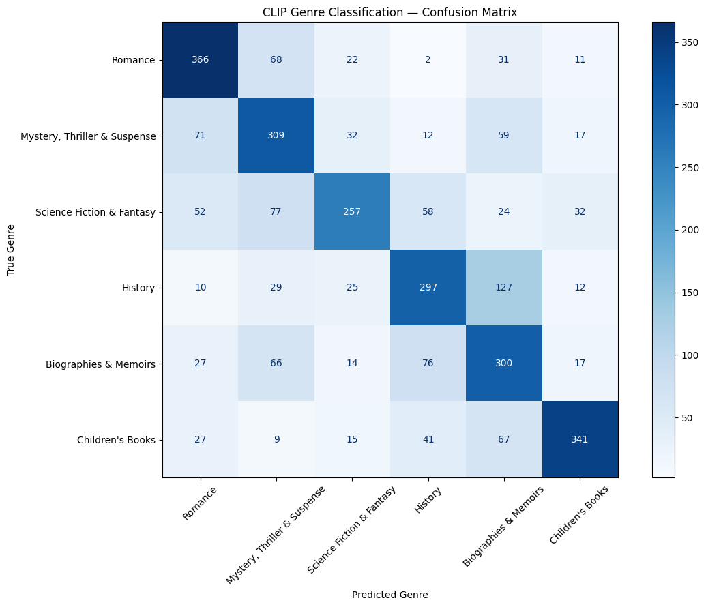
    


### 3.2 Investigating History–Biography Confusion

Examine book covers that CLIP incorrectly classifies as Biographies & Memoirs instead of History, and compare them with correctly classified History covers.


```python

# History books incorrectly predicted as Biographies
history_errors = selected_df[
    (selected_df["Category"] == "History") &
    (selected_df["predicted_genre"] == "Biographies & Memoirs")
]

# Correctly predicted History books
history_correct = selected_df[
    (selected_df["Category"] == "History") &
    (selected_df["predicted_genre"] == "History")
]

print("History → Biography errors:", len(history_errors))
print("Correct History predictions:", len(history_correct))

fig, axes = plt.subplots(2, 6, figsize=(16, 8))

for row, (data, label) in enumerate([
    (history_errors, "Misclassified"),
    (history_correct, "Correct")
]):
    samples = data.sample(n=6, random_state=42)

    for col, (_, book) in enumerate(samples.iterrows()):
        image = Image.open(book["image_path"]).convert("RGB")
        axes[row, col].imshow(image)
        axes[row, col].axis("off")

        if col == 0:
            axes[row, col].set_ylabel(
                label,
                fontsize=12,
                rotation=90,
                labelpad=10
            )

plt.suptitle(
    "History Books: Misclassified vs Correctly Classified",
    fontsize=15
)
plt.tight_layout()
plt.show()

```

    History → Biography errors: 127
    Correct History predictions: 297
    


    
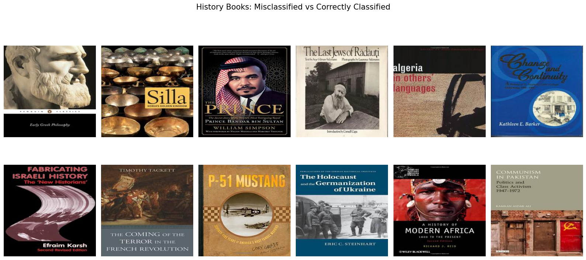
    


### 3.3 Testing the Face-Presence Hypothesis

Investigate whether History book covers containing detectable human faces are more frequently misclassified as Biographies & Memoirs.


```python
%pip install opencv-python
```

    Requirement already satisfied: opencv-python in /opt/homebrew/lib/python3.11/site-packages (4.13.0.90)
    Requirement already satisfied: numpy>=2 in /opt/homebrew/lib/python3.11/site-packages (from opencv-python) (2.4.6)
    
    [notice] A new release of pip is available: 23.3.1 -> 26.3
    [notice] To update, run: python3.11 -m pip install --upgrade pip
    Note: you may need to restart the kernel to use updated packages.
    


```python
import cv2
from tqdm.auto import tqdm

# Load a pre-trained face detector
face_cascade = cv2.CascadeClassifier(
    cv2.data.haarcascades + "haarcascade_frontalface_default.xml"
)

def has_face(image_path):
    image = cv2.imread(image_path)
    if image is None:
        return False

    gray = cv2.cvtColor(image, cv2.COLOR_BGR2GRAY)

    faces = face_cascade.detectMultiScale(
        gray,
        scaleFactor=1.1,
        minNeighbors=4,
        minSize=(20, 20)
    )

    return len(faces) > 0

# Analyze all History covers
history_df = selected_df[
    selected_df["Category"] == "History"
].copy()

history_df["has_face"] = [
    has_face(path)
    for path in tqdm(history_df["image_path"])
]

print("Total History covers:", len(history_df))
print("Covers with detected faces:", history_df["has_face"].sum())

display(pd.crosstab(
    history_df["has_face"],
    history_df["predicted_genre"] == "Biographies & Memoirs",
    rownames=["Face detected"],
    colnames=["Predicted as Biography"]
))

```


      0%|          | 0/500 [00:00<?, ?it/s]


    Total History covers: 500
    Covers with detected faces: 33
    


<div>
<style scoped>
    .dataframe tbody tr th:only-of-type {
        vertical-align: middle;
    }

    .dataframe tbody tr th {
        vertical-align: top;
    }

    .dataframe thead th {
        text-align: right;
    }
</style>
<table border="1" class="dataframe">
  <thead>
    <tr style="text-align: right;">
      <th>Predicted as Biography</th>
      <th>False</th>
      <th>True</th>
    </tr>
    <tr>
      <th>Face detected</th>
      <th></th>
      <th></th>
    </tr>
  </thead>
  <tbody>
    <tr>
      <th>False</th>
      <td>358</td>
      <td>109</td>
    </tr>
    <tr>
      <th>True</th>
      <td>15</td>
      <td>18</td>
    </tr>
  </tbody>
</table>
</div>


### 3.4 Face Presence and Genre Confusion

Compare the proportion of History covers predicted as Biographies & Memoirs between images with and without detected faces.


```python
# Calculate biography prediction rates
history_df["predicted_bio"] = (
    history_df["predicted_genre"] == "Biographies & Memoirs"
)

face_rates = (
    history_df.groupby("has_face")["predicted_bio"]
    .mean() * 100
)

fig, ax = plt.subplots(figsize=(8, 5))

bars = ax.bar(
    ["No face detected", "Face detected"],
    [face_rates[False], face_rates[True]],
    color=["steelblue", "coral"]
)

for bar in bars:
    ax.text(
        bar.get_x() + bar.get_width() / 2,
        bar.get_height() + 1,
        f"{bar.get_height():.1f}%",
        ha="center",
        fontsize=12
    )

ax.set_ylabel("Predicted as Biography (%)")
ax.set_title("Does Face Presence Influence CLIP Predictions?")
ax.set_ylim(0, 65)

plt.tight_layout()
plt.show()

```


    
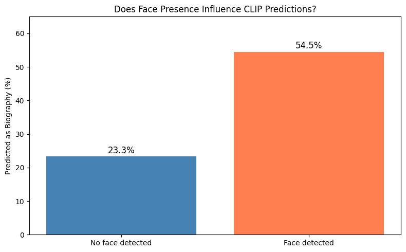
    


**Finding 1 — Face Presence and Genre Confusion**

Among History book covers, CLIP predicted Biographies & Memoirs for 54.5% of images with detected faces, compared to 23.3% without detected faces.

This suggests an association between visible faces and genre confusion. However, the face detector may miss small, illustrated, or historical faces, so the result does not establish causation.


### 3.5 Cover Brightness and Genre Confusion

Investigate whether darker Romance book covers are more likely to be classified as Mystery, Thriller & Suspense.

We measure the average brightness of each cover and compare prediction rates across brightness groups.


```python

import numpy as np
from PIL import Image

# Calculate average grayscale brightness (0–255)
def get_brightness(image_path):
    with Image.open(image_path) as img:
        gray = img.convert("L")
        return np.asarray(gray).mean()

# Select Romance covers
romance_df = selected_df[
    selected_df["Category"] == "Romance"
].copy()

romance_df["brightness"] = romance_df["image_path"].apply(
    get_brightness
)

romance_df["predicted_thriller"] = (
    romance_df["predicted_genre"] ==
    "Mystery, Thriller & Suspense"
)

# Divide covers into four equally sized brightness groups
romance_df["brightness_group"] = pd.qcut(
    romance_df["brightness"],
    q=4,
    labels=["Darkest", "Dark", "Bright", "Brightest"]
)

# Calculate Thriller prediction rate for each group
brightness_results = (
    romance_df.groupby("brightness_group", observed=True)
    ["predicted_thriller"]
    .agg(["count", "sum", "mean"])
)

brightness_results["mean"] *= 100

display(
    brightness_results.rename(columns={
        "count": "Total covers",
        "sum": "Predicted as Thriller",
        "mean": "Thriller prediction (%)"
    }).round(1)
)

```


<div>
<style scoped>
    .dataframe tbody tr th:only-of-type {
        vertical-align: middle;
    }

    .dataframe tbody tr th {
        vertical-align: top;
    }

    .dataframe thead th {
        text-align: right;
    }
</style>
<table border="1" class="dataframe">
  <thead>
    <tr style="text-align: right;">
      <th></th>
      <th>Total covers</th>
      <th>Predicted as Thriller</th>
      <th>Thriller prediction (%)</th>
    </tr>
    <tr>
      <th>brightness_group</th>
      <th></th>
      <th></th>
      <th></th>
    </tr>
  </thead>
  <tbody>
    <tr>
      <th>Darkest</th>
      <td>125</td>
      <td>29</td>
      <td>23.2</td>
    </tr>
    <tr>
      <th>Dark</th>
      <td>125</td>
      <td>21</td>
      <td>16.8</td>
    </tr>
    <tr>
      <th>Bright</th>
      <td>125</td>
      <td>13</td>
      <td>10.4</td>
    </tr>
    <tr>
      <th>Brightest</th>
      <td>125</td>
      <td>5</td>
      <td>4.0</td>
    </tr>
  </tbody>
</table>
</div>


### 3.6 Brightness and Genre Misclassification

Visualize how the proportion of Romance covers misclassified as Mystery, Thriller & Suspense changes across four brightness groups.


```python
labels = ["Darkest", "Dark", "Bright", "Brightest"]
rates = brightness_results.loc[labels, "mean"]

fig, ax = plt.subplots(figsize=(9, 5))

bars = ax.bar(
    labels,
    rates,
    color=["#34324A", "#67627F", "#A9A5C4", "#DCD9ED"]
)

for bar in bars:
    ax.text(
        bar.get_x() + bar.get_width() / 2,
        bar.get_height() + 0.5,
        f"{bar.get_height():.1f}%",
        ha="center",
        fontsize=11
    )

ax.set_ylabel("Predicted as Thriller (%)")
ax.set_xlabel("Cover Brightness Group")
ax.set_title("Romance Covers: Brightness vs Thriller Predictions")
ax.set_ylim(0, 28)

plt.tight_layout()
plt.show()

```


    
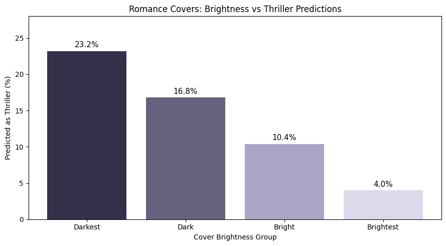
    


**Finding 2 — Cover Brightness and Genre Confusion**

Among 500 Romance covers, the proportion classified as Mystery, Thriller & Suspense decreased consistently with increasing brightness:

- Darkest: 23.2%
- Dark: 16.8%
- Bright: 10.4%
- Brightest: 4.0%

The darkest covers were 5.8 times more likely to be classified as Thriller than the brightest covers.

This supports an association between cover brightness and genre predictions, but does not establish that brightness itself causes the classification errors.


## 4. Prompt Sensitivity Analysis

### 4.1 Comparing Prompt Templates

Investigate whether different text descriptions of book genres influence CLIP's predictions.

We compare a neutral genre description with a more descriptive prompt containing common genre-related themes and visual stereotypes.


```python
# Original neutral prompts
neutral_prompts = [
    f"A book cover of a {genre} book."
    for genre in selected_genres
]

# More descriptive genre prompts
descriptive_prompts = [
    "A book cover of a romantic love story novel.",
    "A book cover of a mysterious crime thriller novel.",
    "A book cover of a science fiction or fantasy adventure novel.",
    "A book cover of a historical nonfiction book.",
    "A book cover of a biography about a person's life.",
    "A book cover of a children's illustrated storybook."
]

# Display both prompt sets
for genre, neutral, descriptive in zip(
    selected_genres, neutral_prompts, descriptive_prompts
):
    print(f"\nGenre: {genre}")
    print(f"Neutral:     {neutral}")
    print(f"Descriptive: {descriptive}")

```

    
    Genre: Romance
    Neutral:     A book cover of a Romance book.
    Descriptive: A book cover of a romantic love story novel.
    
    Genre: Mystery, Thriller & Suspense
    Neutral:     A book cover of a Mystery, Thriller & Suspense book.
    Descriptive: A book cover of a mysterious crime thriller novel.
    
    Genre: Science Fiction & Fantasy
    Neutral:     A book cover of a Science Fiction & Fantasy book.
    Descriptive: A book cover of a science fiction or fantasy adventure novel.
    
    Genre: History
    Neutral:     A book cover of a History book.
    Descriptive: A book cover of a historical nonfiction book.
    
    Genre: Biographies & Memoirs
    Neutral:     A book cover of a Biographies & Memoirs book.
    Descriptive: A book cover of a biography about a person's life.
    
    Genre: Children's Books
    Neutral:     A book cover of a Children's Books book.
    Descriptive: A book cover of a children's illustrated storybook.
    


### 4.2 Predictions with Descriptive Prompts

Run CLIP on the same 3,000 book covers using descriptive genre prompts. Compare the new predictions with the original neutral-prompt baseline.


```python
# Run CLIP with descriptive prompts
descriptive_probabilities = []

for start in tqdm(range(0, len(selected_df), batch_size)):
    batch = selected_df.iloc[start:start + batch_size]

    images = []
    for path in batch["image_path"]:
        with Image.open(path) as img:
            images.append(img.convert("RGB"))

    inputs = processor(
        text=descriptive_prompts,
        images=images,
        return_tensors="pt",
        padding=True
    ).to(device)

    with torch.inference_mode():
        outputs = model(**inputs)
        probs = outputs.logits_per_image.softmax(dim=1)

    descriptive_probabilities.append(probs.cpu().numpy())

descriptive_probabilities = np.concatenate(
    descriptive_probabilities, axis=0
)

# Store new predictions
selected_df["descriptive_prediction"] = [
    selected_genres[i]
    for i in descriptive_probabilities.argmax(axis=1)
]

selected_df["descriptive_correct"] = (
    selected_df["Category"] == selected_df["descriptive_prediction"]
)

# Compare results
neutral_accuracy = selected_df["correct"].mean()
descriptive_accuracy = selected_df["descriptive_correct"].mean()

changed_predictions = (
    selected_df["predicted_genre"] !=
    selected_df["descriptive_prediction"]
).sum()

print(f"Neutral accuracy: {neutral_accuracy:.2%}")
print(f"Descriptive accuracy: {descriptive_accuracy:.2%}")
print(f"Changed predictions: {changed_predictions} / {len(selected_df)}")
print(f"Prediction change rate: {changed_predictions / len(selected_df):.2%}")

# Save updated results
selected_df.to_csv("clip_predictions.csv", index=False)

```


      0%|          | 0/188 [00:00<?, ?it/s]


    Neutral accuracy: 62.33%
    Descriptive accuracy: 52.30%
    Changed predictions: 1199 / 3000
    Prediction change rate: 39.97%
    


### 4.3 Classification Accuracy by Genre

Compare classification accuracy for each genre using neutral and descriptive prompts.

We investigate which genres benefit from descriptive prompts and which become more difficult for CLIP to classify.


```python
# Compare accuracy for each genre
genre_comparison = (
    selected_df.groupby("Category")
    .agg(
        neutral_accuracy=("correct", "mean"),
        descriptive_accuracy=("descriptive_correct", "mean")
    )
    * 100
)

genre_comparison["difference"] = (
    genre_comparison["descriptive_accuracy"]
    - genre_comparison["neutral_accuracy"]
)

display(genre_comparison.round(2))

# Visualize the comparison
ax = genre_comparison[
    ["neutral_accuracy", "descriptive_accuracy"]
].plot(
    kind="bar",
    figsize=(11, 6),
    width=0.75
)

ax.set_title("CLIP Accuracy by Genre: Neutral vs Descriptive Prompts")
ax.set_xlabel("Book Genre")
ax.set_ylabel("Accuracy (%)")
ax.set_ylim(0, 100)
ax.legend(["Neutral", "Descriptive"])

plt.xticks(rotation=35, ha="right")
plt.tight_layout()
plt.show()

```


<div>
<style scoped>
    .dataframe tbody tr th:only-of-type {
        vertical-align: middle;
    }

    .dataframe tbody tr th {
        vertical-align: top;
    }

    .dataframe thead th {
        text-align: right;
    }
</style>
<table border="1" class="dataframe">
  <thead>
    <tr style="text-align: right;">
      <th></th>
      <th>neutral_accuracy</th>
      <th>descriptive_accuracy</th>
      <th>difference</th>
    </tr>
    <tr>
      <th>Category</th>
      <th></th>
      <th></th>
      <th></th>
    </tr>
  </thead>
  <tbody>
    <tr>
      <th>Biographies &amp; Memoirs</th>
      <td>60.0</td>
      <td>39.8</td>
      <td>-20.2</td>
    </tr>
    <tr>
      <th>Children's Books</th>
      <td>68.2</td>
      <td>57.6</td>
      <td>-10.6</td>
    </tr>
    <tr>
      <th>History</th>
      <td>59.4</td>
      <td>85.2</td>
      <td>25.8</td>
    </tr>
    <tr>
      <th>Mystery, Thriller &amp; Suspense</th>
      <td>61.8</td>
      <td>26.4</td>
      <td>-35.4</td>
    </tr>
    <tr>
      <th>Romance</th>
      <td>73.2</td>
      <td>41.4</td>
      <td>-31.8</td>
    </tr>
    <tr>
      <th>Science Fiction &amp; Fantasy</th>
      <td>51.4</td>
      <td>63.4</td>
      <td>12.0</td>
    </tr>
  </tbody>
</table>
</div>


    
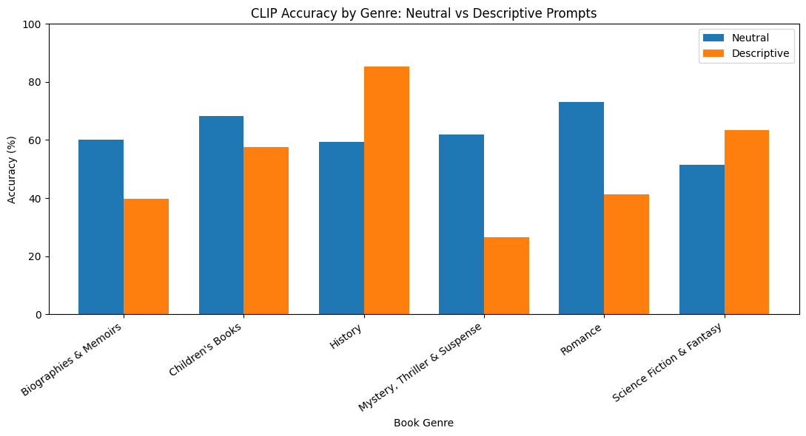
    


### 4.4 Changes in Genre Predictions

Analyze how CLIP's predictions shift between neutral and descriptive prompts.

We focus on which genres gain or lose predictions and identify the most common transitions between predicted genres.


```python
# Count predictions for each genre
prediction_counts = pd.DataFrame({
    "Neutral": selected_df["predicted_genre"].value_counts(),
    "Descriptive": selected_df["descriptive_prediction"].value_counts()
}).reindex(selected_genres).fillna(0).astype(int)

prediction_counts["Difference"] = (
    prediction_counts["Descriptive"] - prediction_counts["Neutral"]
)

display(prediction_counts)

# Visualize how prediction counts change
ax = prediction_counts[["Neutral", "Descriptive"]].plot(
    kind="bar",
    figsize=(11, 5),
    width=0.75
)

ax.set_title("How Prompt Wording Changes CLIP's Genre Predictions")
ax.set_xlabel("Predicted Genre")
ax.set_ylabel("Number of Covers")
ax.legend(title="Prompt Type")

plt.xticks(rotation=35, ha="right")
plt.tight_layout()
plt.show()

# Most frequent changes between predicted genres
changed_df = selected_df[
    selected_df["predicted_genre"] !=
    selected_df["descriptive_prediction"]
]

transitions = (
    changed_df.groupby(
        ["predicted_genre", "descriptive_prediction"]
    )
    .size()
    .sort_values(ascending=False)
    .head(10)
    .reset_index(name="Count")
)

display(transitions)

```


<div>
<style scoped>
    .dataframe tbody tr th:only-of-type {
        vertical-align: middle;
    }

    .dataframe tbody tr th {
        vertical-align: top;
    }

    .dataframe thead th {
        text-align: right;
    }
</style>
<table border="1" class="dataframe">
  <thead>
    <tr style="text-align: right;">
      <th></th>
      <th>Neutral</th>
      <th>Descriptive</th>
      <th>Difference</th>
    </tr>
  </thead>
  <tbody>
    <tr>
      <th>Romance</th>
      <td>553</td>
      <td>240</td>
      <td>-313</td>
    </tr>
    <tr>
      <th>Mystery, Thriller &amp; Suspense</th>
      <td>558</td>
      <td>219</td>
      <td>-339</td>
    </tr>
    <tr>
      <th>Science Fiction &amp; Fantasy</th>
      <td>365</td>
      <td>519</td>
      <td>154</td>
    </tr>
    <tr>
      <th>History</th>
      <td>486</td>
      <td>1168</td>
      <td>682</td>
    </tr>
    <tr>
      <th>Biographies &amp; Memoirs</th>
      <td>608</td>
      <td>487</td>
      <td>-121</td>
    </tr>
    <tr>
      <th>Children's Books</th>
      <td>430</td>
      <td>367</td>
      <td>-63</td>
    </tr>
  </tbody>
</table>
</div>


    
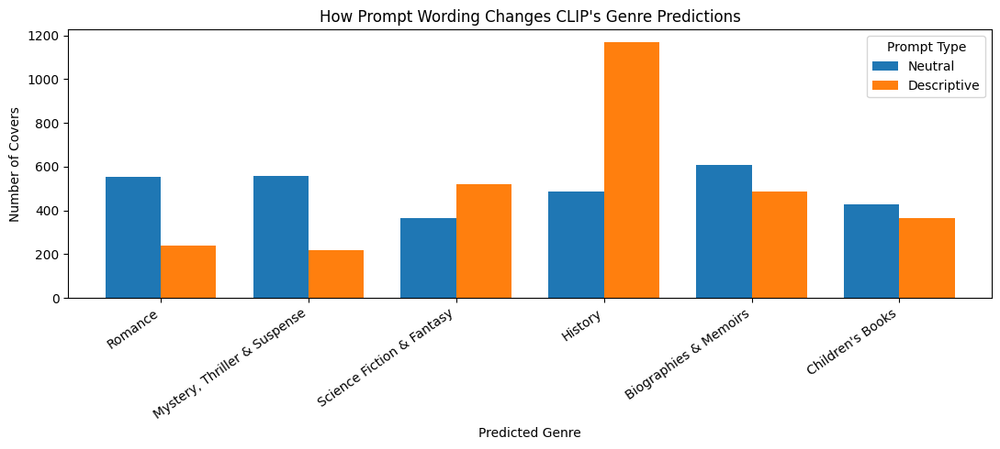
    


<div>
<style scoped>
    .dataframe tbody tr th:only-of-type {
        vertical-align: middle;
    }

    .dataframe tbody tr th {
        vertical-align: top;
    }

    .dataframe thead th {
        text-align: right;
    }
</style>
<table border="1" class="dataframe">
  <thead>
    <tr style="text-align: right;">
      <th></th>
      <th>predicted_genre</th>
      <th>descriptive_prediction</th>
      <th>Count</th>
    </tr>
  </thead>
  <tbody>
    <tr>
      <th>0</th>
      <td>Biographies &amp; Memoirs</td>
      <td>History</td>
      <td>307</td>
    </tr>
    <tr>
      <th>1</th>
      <td>Mystery, Thriller &amp; Suspense</td>
      <td>History</td>
      <td>176</td>
    </tr>
    <tr>
      <th>2</th>
      <td>Romance</td>
      <td>History</td>
      <td>122</td>
    </tr>
    <tr>
      <th>3</th>
      <td>Mystery, Thriller &amp; Suspense</td>
      <td>Science Fiction &amp; Fantasy</td>
      <td>99</td>
    </tr>
    <tr>
      <th>4</th>
      <td>Romance</td>
      <td>Biographies &amp; Memoirs</td>
      <td>92</td>
    </tr>
    <tr>
      <th>5</th>
      <td>Mystery, Thriller &amp; Suspense</td>
      <td>Biographies &amp; Memoirs</td>
      <td>74</td>
    </tr>
    <tr>
      <th>6</th>
      <td>Romance</td>
      <td>Science Fiction &amp; Fantasy</td>
      <td>74</td>
    </tr>
    <tr>
      <th>7</th>
      <td>Children's Books</td>
      <td>History</td>
      <td>62</td>
    </tr>
    <tr>
      <th>8</th>
      <td>Science Fiction &amp; Fantasy</td>
      <td>History</td>
      <td>49</td>
    </tr>
    <tr>
      <th>9</th>
      <td>Children's Books</td>
      <td>Biographies &amp; Memoirs</td>
      <td>22</td>
    </tr>
  </tbody>
</table>
</div>


### 4.5 Corrected Predictions vs New Errors

Investigate whether changing the prompts corrects previous classification errors or introduces new ones.

We also examine how often books from other genres are incorrectly classified as History after switching to descriptive prompts.


```python
# Compare correctness before and after changing prompts
selected_df["prediction_outcome"] = np.select(
    [
        selected_df["correct"] & selected_df["descriptive_correct"],
        ~selected_df["correct"] & selected_df["descriptive_correct"],
        selected_df["correct"] & ~selected_df["descriptive_correct"],
        ~selected_df["correct"] & ~selected_df["descriptive_correct"]
    ],
    [
        "Correct in both",
        "Corrected by descriptive",
        "New error from descriptive",
        "Wrong in both"
    ],
    default="Unknown"
)

outcome_counts = selected_df["prediction_outcome"].value_counts()

display(outcome_counts.to_frame("Number of covers"))

# Analyze History predictions
history_analysis = selected_df[
    selected_df["descriptive_prediction"] == "History"
]

print("Total predicted as History:", len(history_analysis))
print(
    "Actually History:",
    (history_analysis["Category"] == "History").sum()
)
print(
    "Actually another genre:",
    (history_analysis["Category"] != "History").sum()
)

# Plot prediction outcomes
plt.figure(figsize=(10, 5))

order = [
    "Correct in both",
    "Corrected by descriptive",
    "New error from descriptive",
    "Wrong in both"
]

bars = plt.bar(
    order,
    outcome_counts.reindex(order, fill_value=0),
    color=["#4C9F70", "#78B7D0", "#E77C70", "#A0A0A0"]
)

plt.bar_label(bars, padding=3)
plt.title("Impact of Descriptive Prompts on CLIP Predictions")
plt.ylabel("Number of Book Covers")
plt.xticks(rotation=15, ha="right")
plt.tight_layout()
plt.show()

```


<div>
<style scoped>
    .dataframe tbody tr th:only-of-type {
        vertical-align: middle;
    }

    .dataframe tbody tr th {
        vertical-align: top;
    }

    .dataframe thead th {
        text-align: right;
    }
</style>
<table border="1" class="dataframe">
  <thead>
    <tr style="text-align: right;">
      <th></th>
      <th>Number of covers</th>
    </tr>
    <tr>
      <th>prediction_outcome</th>
      <th></th>
    </tr>
  </thead>
  <tbody>
    <tr>
      <th>Correct in both</th>
      <td>1295</td>
    </tr>
    <tr>
      <th>Wrong in both</th>
      <td>856</td>
    </tr>
    <tr>
      <th>New error from descriptive</th>
      <td>575</td>
    </tr>
    <tr>
      <th>Corrected by descriptive</th>
      <td>274</td>
    </tr>
  </tbody>
</table>
</div>


    Total predicted as History: 1168
    Actually History: 426
    Actually another genre: 742
    


    
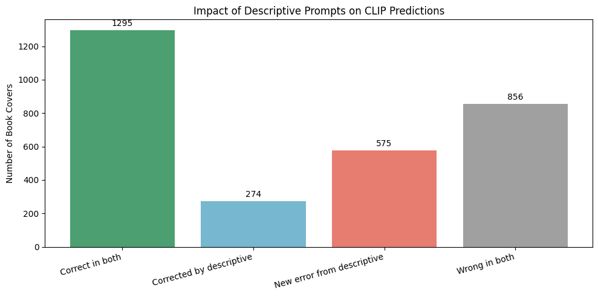
    


### 4.6 Visual Inspection of Changed Predictions

Compare book covers where descriptive prompts corrected previous errors with covers where they introduced new errors.

We inspect whether the affected covers share visual characteristics such as colors, typography, portraits, or illustrations.


```python
import matplotlib.pyplot as plt
from PIL import Image

def show_prediction_examples(outcome, n=6):
    examples = selected_df[
        selected_df["prediction_outcome"] == outcome
    ].sample(
        n=min(n, (selected_df["prediction_outcome"] == outcome).sum()),
        random_state=42
    )

    fig, axes = plt.subplots(1, len(examples), figsize=(16, 4))

    for ax, (_, book) in zip(axes, examples.iterrows()):
        with Image.open(book["image_path"]) as img:
            ax.imshow(img.convert("RGB"))

        ax.set_title(
            f"True: {book['Category']}\n"
            f"Neutral: {book['predicted_genre']}\n"
            f"Descriptive: {book['descriptive_prediction']}",
            fontsize=8
        )
        ax.axis("off")

    plt.suptitle(outcome, fontsize=14)
    plt.tight_layout()
    plt.show()

show_prediction_examples("Corrected by descriptive")
show_prediction_examples("New error from descriptive")

```


    
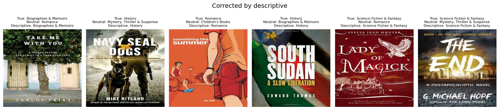
    


    
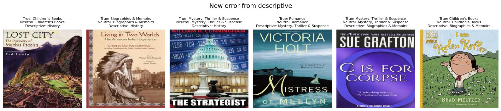
    


### 4.7 Investigating History Prediction Bias

Descriptive prompts substantially increased the number of books classified as History.

We investigate which true genres contribute to these predictions and whether the increase mainly reflects corrected predictions or new classification errors.


```python
# Compare true genres among books predicted as History
history_comparison = pd.DataFrame({
    "Neutral": selected_df[
        selected_df["predicted_genre"] == "History"
    ]["Category"].value_counts(),

    "Descriptive": selected_df[
        selected_df["descriptive_prediction"] == "History"
    ]["Category"].value_counts()
}).reindex(selected_genres, fill_value=0).fillna(0).astype(int)

history_comparison["Difference"] = (
    history_comparison["Descriptive"] -
    history_comparison["Neutral"]
)

display(history_comparison)

# Plot the composition of History predictions
ax = history_comparison[
    ["Neutral", "Descriptive"]
].plot(
    kind="bar",
    figsize=(11, 5),
    width=0.75
)

ax.set_title("True Genres of Books Predicted as History")
ax.set_xlabel("Actual Book Genre")
ax.set_ylabel("Number of Covers Predicted as History")
ax.legend(title="Prompt Type")

plt.xticks(rotation=35, ha="right")
plt.tight_layout()
plt.show()

```


<div>
<style scoped>
    .dataframe tbody tr th:only-of-type {
        vertical-align: middle;
    }

    .dataframe tbody tr th {
        vertical-align: top;
    }

    .dataframe thead th {
        text-align: right;
    }
</style>
<table border="1" class="dataframe">
  <thead>
    <tr style="text-align: right;">
      <th></th>
      <th>Neutral</th>
      <th>Descriptive</th>
      <th>Difference</th>
    </tr>
    <tr>
      <th>Category</th>
      <th></th>
      <th></th>
      <th></th>
    </tr>
  </thead>
  <tbody>
    <tr>
      <th>Romance</th>
      <td>2</td>
      <td>96</td>
      <td>94</td>
    </tr>
    <tr>
      <th>Mystery, Thriller &amp; Suspense</th>
      <td>12</td>
      <td>172</td>
      <td>160</td>
    </tr>
    <tr>
      <th>Science Fiction &amp; Fantasy</th>
      <td>58</td>
      <td>99</td>
      <td>41</td>
    </tr>
    <tr>
      <th>History</th>
      <td>297</td>
      <td>426</td>
      <td>129</td>
    </tr>
    <tr>
      <th>Biographies &amp; Memoirs</th>
      <td>76</td>
      <td>258</td>
      <td>182</td>
    </tr>
    <tr>
      <th>Children's Books</th>
      <td>41</td>
      <td>117</td>
      <td>76</td>
    </tr>
  </tbody>
</table>
</div>


    
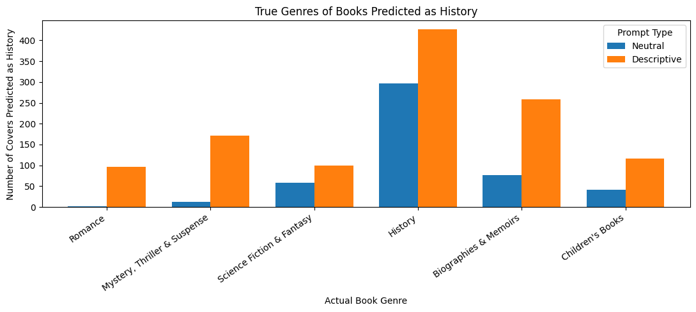
    


**Observation:** Descriptive prompts strongly increase the number of books predicted as History, from 486 to 1,168.

Although correct History predictions increase from 297 to 426, incorrect History predictions also increase substantially, from 189 to 742.

The largest increases in misclassification come from Biographies & Memoirs, Mystery/Thriller, and Romance.

This suggests that CLIP's predictions are highly sensitive to prompt wording. The descriptive prompts introduce a strong prediction bias toward History, even for books belonging to other genres.


```python
import pandas as pd

results_df = pd.read_csv("clip_predictions.csv")

print("Total books:", len(results_df))
print("\nAvailable columns:")
print(results_df.columns.tolist())

display(results_df.head())

```

    Total books: 3000
    
    Available columns:
    ['Amazon Index (ASIN)', 'Filename', 'Image URL', 'Title', 'Author', 'Category ID', 'Category', 'image_path', 'image_exists', 'predicted_genre', 'confidence', 'prob_0', 'prob_1', 'prob_2', 'prob_3', 'prob_4', 'prob_5', 'correct', 'descriptive_prediction', 'descriptive_correct']
    


<div>
<style scoped>
    .dataframe tbody tr th:only-of-type {
        vertical-align: middle;
    }

    .dataframe tbody tr th {
        vertical-align: top;
    }

    .dataframe thead th {
        text-align: right;
    }
</style>
<table border="1" class="dataframe">
  <thead>
    <tr style="text-align: right;">
      <th></th>
      <th>Amazon Index (ASIN)</th>
      <th>Filename</th>
      <th>Image URL</th>
      <th>Title</th>
      <th>Author</th>
      <th>Category ID</th>
      <th>Category</th>
      <th>image_path</th>
      <th>image_exists</th>
      <th>predicted_genre</th>
      <th>confidence</th>
      <th>prob_0</th>
      <th>prob_1</th>
      <th>prob_2</th>
      <th>prob_3</th>
      <th>prob_4</th>
      <th>prob_5</th>
      <th>correct</th>
      <th>descriptive_prediction</th>
      <th>descriptive_correct</th>
    </tr>
  </thead>
  <tbody>
    <tr>
      <th>0</th>
      <td>761526463</td>
      <td>0761526463.jpg</td>
      <td>http://ecx.images-amazon.com/images/I/51FRDny0...</td>
      <td>The Real Lincoln: A New Look at Abraham Lincol...</td>
      <td>Thomas DiLorenzo</td>
      <td>1</td>
      <td>Biographies &amp; Memoirs</td>
      <td>archive/title30cat/224x224/0761526463.jpg</td>
      <td>True</td>
      <td>History</td>
      <td>0.544140</td>
      <td>0.002037</td>
      <td>0.003603</td>
      <td>0.001633</td>
      <td>0.544140</td>
      <td>0.445583</td>
      <td>0.003004</td>
      <td>False</td>
      <td>History</td>
      <td>False</td>
    </tr>
    <tr>
      <th>1</th>
      <td>804139377</td>
      <td>0804139377.jpg</td>
      <td>http://ecx.images-amazon.com/images/I/51PMjKRg...</td>
      <td>Brady vs Manning: The Untold Story of the Riva...</td>
      <td>Gary Myers</td>
      <td>1</td>
      <td>Biographies &amp; Memoirs</td>
      <td>archive/title30cat/224x224/0804139377.jpg</td>
      <td>True</td>
      <td>Biographies &amp; Memoirs</td>
      <td>0.589095</td>
      <td>0.017394</td>
      <td>0.025131</td>
      <td>0.002921</td>
      <td>0.342709</td>
      <td>0.589095</td>
      <td>0.022751</td>
      <td>True</td>
      <td>History</td>
      <td>False</td>
    </tr>
    <tr>
      <th>2</th>
      <td>1600787711</td>
      <td>1600787711.jpg</td>
      <td>http://ecx.images-amazon.com/images/I/51I-Jg4h...</td>
      <td>Hockeytown Doc: A Half-Century of Red Wings St...</td>
      <td>Dr. John Finley</td>
      <td>1</td>
      <td>Biographies &amp; Memoirs</td>
      <td>archive/title30cat/224x224/1600787711.jpg</td>
      <td>True</td>
      <td>Biographies &amp; Memoirs</td>
      <td>0.582719</td>
      <td>0.009381</td>
      <td>0.013589</td>
      <td>0.006991</td>
      <td>0.368249</td>
      <td>0.582719</td>
      <td>0.019070</td>
      <td>True</td>
      <td>History</td>
      <td>False</td>
    </tr>
    <tr>
      <th>3</th>
      <td>670888125</td>
      <td>0670888125.jpg</td>
      <td>http://ecx.images-amazon.com/images/I/51D2GXVX...</td>
      <td>Wooden Boats</td>
      <td>Michael Ruhlman</td>
      <td>1</td>
      <td>Biographies &amp; Memoirs</td>
      <td>archive/title30cat/224x224/0670888125.jpg</td>
      <td>True</td>
      <td>Biographies &amp; Memoirs</td>
      <td>0.442351</td>
      <td>0.163939</td>
      <td>0.176535</td>
      <td>0.004146</td>
      <td>0.136468</td>
      <td>0.442351</td>
      <td>0.076562</td>
      <td>True</td>
      <td>History</td>
      <td>False</td>
    </tr>
    <tr>
      <th>4</th>
      <td>71781773</td>
      <td>0071781773.jpg</td>
      <td>http://ecx.images-amazon.com/images/I/51xluzzt...</td>
      <td>Tell It Slant, 2nd Edition</td>
      <td>Brenda Miller</td>
      <td>1</td>
      <td>Biographies &amp; Memoirs</td>
      <td>archive/title30cat/224x224/0071781773.jpg</td>
      <td>True</td>
      <td>Biographies &amp; Memoirs</td>
      <td>0.339129</td>
      <td>0.169402</td>
      <td>0.047246</td>
      <td>0.069800</td>
      <td>0.036468</td>
      <td>0.339129</td>
      <td>0.337955</td>
      <td>True</td>
      <td>History</td>
      <td>False</td>
    </tr>
  </tbody>
</table>
</div>


## Interactive Dashboard

We created an interactive dashboard using **Streamlit**, a Python library for building web applications.

The dashboard allows users to explore CLIP's book genre classification results without running the experiments again. It uses the predictions saved in `clip_predictions.csv` and displays them in an interactive web interface.

### Dashboard Features

The dashboard contains five main sections:

- **Model Overview:** Shows the total number of book covers and the overall classification accuracy for neutral and descriptive prompts.
- **Genre Analysis:** Allows users to select a genre and compare the accuracy of both prompt types.
- **Error Explorer:** Displays misclassified book covers and allows users to filter them by predicted genre and prompt type.
- **Prompt Comparison Explorer:** Shows examples where changing the text prompt changed CLIP's prediction, including corrected predictions and new errors.
- **Confidence Analysis:** Compares confidence scores for correct and incorrect predictions and allows users to investigate high-confidence mistakes.

Users can interact with the dashboard using dropdown menus, sliders, and other controls. The visualizations and displayed examples update automatically based on the selected filters.

### Installation and Setup

To run the dashboard, Python and Streamlit are required.

First, install Streamlit by opening a terminal and running:

```bash
python3 -m pip install streamlit
```

Make sure the following files are available:

- `dashboard.py` — the Streamlit application
- `clip_predictions.csv` — the saved CLIP classification results
- `archive/` — the dataset folder containing the book cover images

The dataset images must be accessible through the paths stored in the CSV file.

### Running the Dashboard

Open a terminal and navigate to the folder containing `dashboard.py`.

For example, if the file is on the Desktop:

```bash
cd ~/Desktop
```

Then start the application:

```bash
python3 -m streamlit run dashboard.py
```

Streamlit will start a local web server. The dashboard can usually be opened in a browser at:

http://localhost:8501

The application runs locally and does not require retraining CLIP.

To stop the dashboard, return to the terminal and press `Ctrl + C`.

### Purpose

The dashboard helps us explore the results of Phase I in a more interactive way. Instead of looking only at static plots, we can filter predictions, inspect individual book covers, and compare different model behaviors.

This makes it easier to identify interesting patterns and investigate classification errors.


## 5. Confidence Analysis

In this section, we investigate how confident CLIP is in its genre predictions.

We compare confidence scores for correct and incorrect predictions and explore cases where the model makes mistakes with high confidence.

Our goal is to understand whether CLIP's confidence is related to its classification accuracy.


```python
import pandas as pd
import matplotlib.pyplot as plt

# Load saved predictions
df = pd.read_csv("clip_predictions.csv")

# Confidence is stored between 0 and 1
df["confidence"] = pd.to_numeric(df["confidence"], errors="coerce")

# Compare correct and incorrect predictions
confidence_summary = (
    df.groupby("correct")["confidence"]
    .agg(["mean", "median", "count"])
    .rename(index={True: "Correct", False: "Incorrect"})
)

display(confidence_summary)

# Visualize confidence distributions
plt.figure(figsize=(10, 5))

plt.hist(
    df.loc[df["correct"] == True, "confidence"].dropna(),
    bins=25,
    alpha=0.6,
    density=True,
    label="Correct"
)

plt.hist(
    df.loc[df["correct"] == False, "confidence"].dropna(),
    bins=25,
    alpha=0.6,
    density=True,
    label="Incorrect"
)

plt.xlabel("CLIP Confidence")
plt.ylabel("Density")
plt.title("Confidence Distribution: Correct vs Incorrect Predictions")
plt.legend()
plt.tight_layout()
plt.show()

```


<div>
<style scoped>
    .dataframe tbody tr th:only-of-type {
        vertical-align: middle;
    }

    .dataframe tbody tr th {
        vertical-align: top;
    }

    .dataframe thead th {
        text-align: right;
    }
</style>
<table border="1" class="dataframe">
  <thead>
    <tr style="text-align: right;">
      <th></th>
      <th>mean</th>
      <th>median</th>
      <th>count</th>
    </tr>
    <tr>
      <th>correct</th>
      <th></th>
      <th></th>
      <th></th>
    </tr>
  </thead>
  <tbody>
    <tr>
      <th>Incorrect</th>
      <td>0.558560</td>
      <td>0.529138</td>
      <td>1130</td>
    </tr>
    <tr>
      <th>Correct</th>
      <td>0.716742</td>
      <td>0.739399</td>
      <td>1870</td>
    </tr>
  </tbody>
</table>
</div>


    
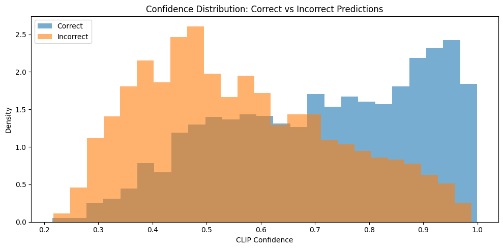
    


### High-Confidence Errors

We investigate how often CLIP makes incorrect predictions at different confidence thresholds.

We use thresholds of 70%, 80%, 90%, and 95% to see whether higher confidence is associated with fewer classification errors.

We also examine whether the model can still make mistakes when it is highly confident.


```python
# Analyze errors at different confidence thresholds

thresholds = [0.7, 0.8, 0.9, 0.95]
results = []

for threshold in thresholds:
    subset = df[df["confidence"] >= threshold]

    total = len(subset)
    incorrect = (~subset["correct"].astype(bool)).sum()

    error_rate = (
        incorrect / total * 100 if total > 0 else 0
    )

    results.append({
        "Confidence threshold": f"{threshold:.0%}",
        "Total predictions": total,
        "Incorrect predictions": incorrect,
        "Error rate (%)": round(error_rate, 2)
    })

confidence_results = pd.DataFrame(results)

display(confidence_results)

```


<div>
<style scoped>
    .dataframe tbody tr th:only-of-type {
        vertical-align: middle;
    }

    .dataframe tbody tr th {
        vertical-align: top;
    }

    .dataframe thead th {
        text-align: right;
    }
</style>
<table border="1" class="dataframe">
  <thead>
    <tr style="text-align: right;">
      <th></th>
      <th>Confidence threshold</th>
      <th>Total predictions</th>
      <th>Incorrect predictions</th>
      <th>Error rate (%)</th>
    </tr>
  </thead>
  <tbody>
    <tr>
      <th>0</th>
      <td>70%</td>
      <td>1306</td>
      <td>259</td>
      <td>19.83</td>
    </tr>
    <tr>
      <th>1</th>
      <td>80%</td>
      <td>881</td>
      <td>136</td>
      <td>15.44</td>
    </tr>
    <tr>
      <th>2</th>
      <td>90%</td>
      <td>452</td>
      <td>49</td>
      <td>10.84</td>
    </tr>
    <tr>
      <th>3</th>
      <td>95%</td>
      <td>207</td>
      <td>15</td>
      <td>7.25</td>
    </tr>
  </tbody>
</table>
</div>


### Confidence Analysis — Findings

We found that CLIP generally makes fewer mistakes when its confidence is higher.

For predictions with confidence of at least 70%, the error rate was 19.83%. This decreased to 10.84% at 90% confidence and 7.25% at 95% confidence.

However, high confidence does not always mean that a prediction is correct. Even at 95% confidence, CLIP incorrectly classified 15 book covers.

This suggests that confidence is useful for identifying more reliable predictions, but the model can still make confident mistakes.


## Final Research Findings — Phase I

### 1. Genre Classification Performance

We evaluated CLIP on 3,000 book covers from six genres, with 500 images per genre.

Using neutral text prompts, CLIP achieved an overall accuracy of 62.3%.

The model performed best on Romance (73.2%) and Children's Books (68.2%). Science Fiction & Fantasy was the most difficult genre, with an accuracy of 51.4%.

The confusion matrix showed that some genres are frequently confused. For example, 127 History books were classified as Biographies & Memoirs.

This suggests that book covers from different genres can share similar visual characteristics.

### 2. Visual Features and Classification Errors

We investigated whether visual features of book covers are associated with CLIP's predictions.

For History books, we tested whether the presence of a detected face was related to predictions of Biographies & Memoirs.

When a face was detected, 54.5% of covers were classified as Biographies. Without a detected face, this happened in 23.3% of cases.

We also investigated brightness in Mystery, Thriller & Suspense covers.

Among the darkest covers, 23.2% were predicted as Thriller, compared with only 4.0% among the brightest covers.

These results suggest that CLIP's predictions are associated with visual cues such as faces and brightness. However, these observations do not prove that these features directly cause the predictions.

### 3. Sensitivity to Prompt Wording

We compared two types of text prompts: neutral genre descriptions and more descriptive prompts.

Neutral prompts achieved 62.3% accuracy, while descriptive prompts achieved 52.3%.

Changing the prompts changed 1,199 out of 3,000 predictions (39.97%).

Descriptive prompts improved performance for History and Science Fiction & Fantasy, but reduced accuracy for several other genres.

One interesting finding was that the number of books predicted as History increased from 486 to 1,168.

This shows that CLIP is sensitive to how genre descriptions are written. More descriptive prompts do not necessarily produce better predictions.

### 4. Corrected Predictions and New Errors

We investigated how descriptive prompts affected individual predictions.

Descriptive prompts corrected 274 previously incorrect predictions, but also introduced 575 new errors.

Another 1,295 predictions were correct with both prompt types, while 856 remained incorrect.

We also examined example book covers to understand these changes.

The results show that changing prompt wording can improve some predictions while making others worse.

### 5. Confidence and Model Reliability

We analyzed CLIP's confidence scores for correct and incorrect predictions.

Correct predictions had a higher average confidence (0.717) than incorrect predictions (0.559).

The error rate decreased as we selected predictions with higher confidence.

For predictions with at least 90% confidence, the error rate was 10.84%. At 95% confidence, the error rate decreased to 7.25%.

However, 15 predictions with at least 95% confidence were still incorrect.

This shows that confidence is related to prediction correctness, but high confidence does not guarantee that CLIP is correct.

### Overall Conclusion

Our experiments show that CLIP can recognize visual patterns associated with book genres, but its predictions have several limitations.

The model sometimes confuses visually similar genres, its predictions are associated with visual characteristics of book covers, and its performance changes considerably depending on prompt wording.

We also found that CLIP can make incorrect predictions with high confidence.

Overall, our findings suggest that CLIP's behavior depends on both the visual input and the text descriptions used for classification.


```python

```
